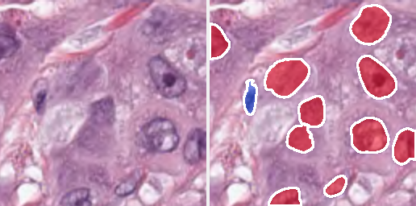
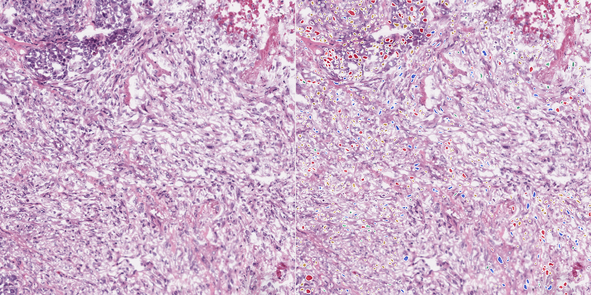

# AI-Powered Digital Pathology Image Analyzer

An interactive web application that takes a histopathology image or a whole-slide
image, finds every individual cell nucleus, draws its boundary, assigns it a cell
type, and produces a quantitative analysis report.



> Research and educational prototype. Not a medical device and not validated for
> clinical or diagnostic use.

---

## The problem

Whole-slide pathology images are enormous — a single `.svs` can be 18000 × 19921
pixels, roughly a gigabyte of pixels and tens of gigabytes on disk. You cannot
load one into memory, and you cannot stare at 359 megapixels to find out how many
cells are in a region.

This application solves that: it streams a slide through a segmentation network
in tiles, keeps memory flat regardless of image size, and hands you a per-nucleus
table plus a summary report.

## What it does

- **Accepts** PNG, TIFF, JPEG and whole-slide images (`.svs`, `.ndpi`, `.tif`) by
  upload, or analyses bundled samples.
- **Detects and segments** every nucleus, drawing each instance boundary
  individually rather than as a blob.
- **Classifies** each nucleus into neoplastic, inflammatory, connective, dead,
  and dead-karyotic tissue.
- **Quantifies** cell counts, type distribution, nucleus size statistics, and
  nuclear density in nuclei/mm² using the slide's microns-per-pixel metadata.
- **Reports** everything as JSON, CSV, a Markdown summary, and PNG overlays.
- **Streams** large slides in bands, so a 359 Mpx slide peaks at ~1.2 GB of RAM
  instead of the several GB a naive implementation would need.

## Results

These are real outputs from running this code, saved in `results/`.

### H&E patch (PanNuke, 256 × 256)


| Metric | Value |
| --- | --- |
| Nuclei detected | 11 |
| Types | Neoplastic 10, Connective 1 |
| Median nucleus area | 995 px |
| Runtime | 0.58 s |

### Whole-slide region (TCGA breast tumour, 18000 × 19921 px)



Processed at full resolution (0.5015 µm/px, 20× objective) from a real
TCGA clinical slide, using the tissue-detection pass to pick the densest region
automatically rather than analysing bare scanner glass.

| Metric | Value |
| --- | --- |
| Nuclei detected | **944** |
| Nuclear density | **1 591 nuclei/mm²** |
| Type distribution | Dead 536, Connective 187, Neoplastic 138, Inflammatory 54 |
| Nucleus size | median 99 px, mean 126 px, 90th percentile 238 px |
| Tiles processed | 529 (stride 64) |
| Wall clock | 28.8 s (≈ 18 tiles/s on one GPU) — 27.9 s inference, 0.9 s post-processing |
| **Peak memory** | **1.22 GB** |

The memory figure is the interesting one: the slide alone is 1.07 GB of raw RGB
pixels, and a straightforward float32 implementation would need roughly 4 GB just
for the prediction buffers. This one never allocates either.

**Throughput**: ≈ 18 tiles/s end to end (34.7 Mpx of input patches per second),
at 0.5 µm/px. A full-resolution whole slide is about 87 000 tiles (~1.3 h);
dropping to pyramid level 1 brings that to roughly 5 500 tiles (~5 minutes), and
the tissue filter discards roughly 70% of a typical slide before inference even
starts.

## How it works

```
                    ┌────────────────────────────────┐
  PNG / TIFF / SVS  │  readers.py                    │  OpenSlide random access
  ─────────────────►│  Array · File · SlideReader    │  — the slide is never
                    │  + tissue detection            │    loaded into memory
                    └───────────────┬────────────────┘
                                    │  256×256 / 270×270 patches
                                    ▼
                    ┌────────────────────────────────┐
                    │  engine.py — Analyzer          │  batched GPU inference
                    │  band streaming + tile blending│  overlapped tiles averaged
                    └───────────────┬────────────────┘
                                    │  nuclei-probability, HoVer distance
                                    │  and type maps
                                    ▼
                    ┌────────────────────────────────┐
                    │  post_proc.py                  │  marker-controlled
                    │  watershed → instances,        │  watershed → one object
                    │  majority-vote typing          │  per nucleus
                    └───────────────┬────────────────┘
                                    ▼
         stats.py ──► overlay.py ──► report.py ──► dashboard.py · CLI
```

### The interesting problems I had to solve

**The network doesn't return a same-size prediction.** HoVer-Net consumes a
270×270 patch but emits only the *central* 80×80 (its training masked the
border). Naively sliding a window and pasting results back leaves gaps and
duplicates nuclei. `tiling.py` encodes the actual contract: it plans 80×80
*output* windows, works out which input patch each one needs, and places every
prediction at exactly the right offset. Windows are spaced closer than their
size, so neighbouring predictions overlap and are averaged — that is what removes
the tiling seams. A test asserts the alignment invariant for every tile.

**Two incompatible architectures.** The two public checkpoints aren't the same
network. One is `original` (5×5 kernels, 80×80 output, 5 classes), the other is
`fast` (3×3, 164×164, 6 classes) — and feeding a 256-pixel patch to the wrong one
crashes on a tensor-size mismatch. Rather than making the user pick, the loader
reads the architecture off the weights themselves: kernel size of the dense-block
convolutions, and width of the type head. Both checkpoints load and run with no
configuration.

**Memory has to stay flat.** The application walks the image in horizontal bands
whose height is computed from a memory budget. Each band is segmented and
released before the next one is allocated, so peak memory depends on
`--band-mb`, not on image dimensions. Inside a band, the watershed runs on
1024×1024 windows with a margin so nuclei straddling a window edge aren't split.

**Slides are mostly not tissue.** Running a network across a gigabyte of blank
scanner glass wastes nearly all the compute. The application scans a downsampled
copy for tissue using a brightness heuristic, then skips windows that contain
none. (Brightness, not HSV saturation — averaging a downsampled tile with the
surrounding glass dilutes saturation, which makes a saturation threshold behave
differently at every pyramid level. That one cost me a debugging session.)

**Coordinates have to survive the trip.** Nuclei are detected inside tiles but
reported in whole-image coordinates, including bounding boxes and polygons. The
ROI system wraps any reader so a sub-region of a 359 Mpx slide can be analysed
exactly like a standalone image, with no separate code path.

## Installation

Requires Python 3.9+ and optionally a CUDA GPU (it falls back to CPU otherwise).

```bash
cd pathology-analyzer
pip install -r requirements.txt
python scripts/fetch_assets.py      # weights + sample data, ~570 MB
```

The asset script downloads everything needed with **no API token or login**, and
is resumable — re-running it skips whatever is already on disk.

| Asset | Source |
| --- | --- |
| Segmentation model checkpoints (×2) | official upstream releases |
| Preact-ResNet50 encoder | official upstream release |
| PanNuke H&E sample patches | `RationAI/PanNuke` on Hugging Face |
| TCGA whole-slide image | NCI Genomic Data Commons, open-access API |

### OpenSlide without root

Whole-slide support normally needs a system package. The `openslide-bin` wheel
bundles the OpenSlide C library, so `pip install` is enough on Linux:

```bash
pip install openslide-python openslide-bin
python -c "import openslide; print(openslide.__library_version__)"
```

## Usage

### Dashboard

```bash
streamlit run app/dashboard.py
```

Upload an image or slide, or pick a bundled sample. The sidebar exposes batch
size, tile stride, minimum nucleus area, and a background-skipping toggle for
slides. Tabs cover the type distribution and size histogram, a filterable
sortable per-nucleus table, and downloads for JSON / CSV / Markdown report /
overlay PNG. Results are cached by file content hash, so revisiting a file is
instant.

### Command line

```bash
# a patch
python scripts/run_analysis.py samples/images/pannuke_00003_256x256.png

# a region of a whole-slide image at full resolution
python scripts/run_analysis.py slide.svs --roi 5816,4748,1536,1536

# whole slide, one pyramid level down, capped tile count
python scripts/run_analysis.py slide.svs --level 1 --max-tiles 2000

# tune the analysis
python scripts/run_analysis.py image.png --stride 48 --min-area 30 --batch-size 16
```

| Output | Contents |
| --- | --- |
| `*_overlay.png` | colour-coded instances with white boundaries |
| `*_comparison.png` | original and overlay side by side |
| `*_analysis.json` | summary, statistics, and every nucleus with contour, bbox, type and confidence |
| `*_nuclei.csv` | one row per nucleus |
| `*_report.md` | human-readable Markdown report |

## Layout

```
pathology-analyzer/
├── app/dashboard.py          Streamlit interface
├── pipeline/
│   ├── stats.py              counts, distribution, density, size statistics
│   └── report.py             JSON / CSV / PNG / Markdown writers
├── scripts/
│   ├── fetch_assets.py       resumable, idempotent asset downloader
│   └── run_analysis.py       CLI
├── src/hovernet/
│   ├── checkpoint.py         checkpoint loading + architecture detection
│   ├── engine.py             batched inference, band streaming, tile blending
│   ├── tiling.py             sliding-window geometry and patch extraction
│   ├── readers.py            array / file / OpenSlide readers, tissue detection
│   ├── overlay.py            overlay and legend rendering
│   ├── net_desc.py           network definition
│   ├── net_utils.py          network building blocks
│   ├── model_utils.py        tensor operations
│   ├── misc_utils.py         geometry helpers
│   └── post_proc.py          watershed instance segmentation
├── tests/                    28 tests
└── requirements.txt
```

## Testing

```bash
python -m pytest tests/ -q          # 28 passed in ~3 s
```

| File | What it covers |
| --- | --- |
| `test_tiling.py` | every pixel covered at any stride with no gaps; the window/patch alignment invariant; interior tiles never altered; both architecture geometries |
| `test_analysis.py` | counts, type fractions, density from microns-per-pixel, size statistics, overlay rendering, and JSON/CSV/Markdown serialisation |
| `test_dashboard.py` | drives the real Streamlit app through its test harness, including loading the checkpoint and running actual inference end to end |

Writing these found three real bugs: a broken path expression in the dashboard,
overlay coordinates drawn against the wrong image for region analyses, and an
overlap bound assumption that didn't hold for small strides.

## Known limitations

Worth being straight about, since the numbers above are model predictions rather
than validated measurements:

- **No fine-tuning or accuracy validation was performed.** The pretrained
  weights are used as released. Reproducing published accuracy would mean
  training on CoNSeP/PanNuke from scratch and scoring against expert
  annotations; no accuracy-vs-ground-truth figure is claimed here because none
  was measured.
- **Segmentation is reliable; classification is not.** Instance boundaries track
  visible nuclei closely in every run above, but type assignment is noticeably
  less stable — note that "Dead" dominates the TCGA result, which is a domain
  mismatch rather than a count of dead cells. Treat the per-nucleus type as a
  weak label and the counts as the trustworthy output.
- **Checkpoint choice matters.** The two checkpoints disagree substantially on
  the same images. The one matching the sample data is the default.
- Very large or overlapping nuclei can still be split across block boundaries.
- Density assumes microns-per-pixel from slide metadata and falls back to a
  stated 0.5 µm/px default when absent; the report always says which was used.


The pretrained checkpoints and pretrained encoder are from the same project.
PanNuke-derived weights are CC BY-NC-SA 4.0, so **this project is configured for
non-commercial and educational use**. TCGA slides come from the NCI Genomic Data
Commons under its open-access policy; OpenSlide is BSD licensed.

## Licence

Code in this repository is mine. Third-party components retain their original
licences as listed above — note that the bundled PanNuke-derived weights are
**non-commercial**.
